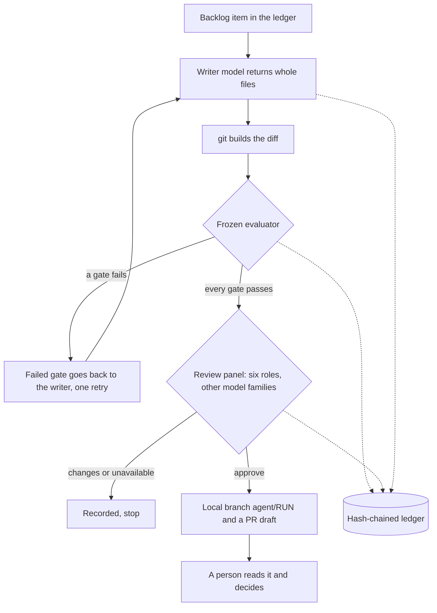

# supervised-self-improving-agent

An agent that proposes changes to its own code, where every change has to get
past a frozen evaluator and an independent review panel, and a person decides
whether anything is merged.

## The problem

Letting a model edit code that later runs unattended is risky in a few specific ways:

- It can weaken the checks that judge it, or write tests that pass no matter what.
- The code it writes can read files, call the network or start processes when the tests run.
- One model reviewing its own work misses the same things it missed while writing.
- Model calls fail in different ways (quota, empty reply, silent error) and cost can creep up.
- Afterwards it is hard to prove what happened, in what order.

This repo is a small, working answer to each of those, built for macOS.

## How it works



One cycle (`bin/heavy_cycle.py --dry-run`):

1. **Pick work.** The highest-priority open backlog item from the ledger, one per area,
   with a 14-day cooldown on an area after something there closes.
2. **Write.** The writer model sees only the task and repository code (fenced as data) and
   replies with whole files. git builds the diff, so miscounted hunk headers cannot break it.
3. **Judge.** The frozen evaluator (`evaluator/evaluate.py`) runs its gates in order; the first
   failure stops it, and nothing from the change runs until every static gate has passed:
   - integrity: the control files match pins kept outside the repo
   - shape, paths, size, deps: no renames, deletions, mode changes or binaries; only
     `agentlib/`, `tests/`, `docs/`; at most 300 lines and 8 files; no dependency files
   - identifiers: no emails or long digit runs anywhere in a changed file
   - code: every changed Python file is parsed whole; imports come from a short list of
     pure-computation modules; no file, process, network, reflection or dynamic execution;
     no test skips, mocks or result forging
   - tests: the change must add at least one test file and may not edit existing tests
   - baseline, suite: the base suite and the candidate suite run in a macOS sandbox (no
     network, no new processes, no reading home or temp folders, writes only to a
     size-limited scratch disk, CPU, memory and time limits)
   - bite: every new test must fail on the old code for a real reason (an assertion, a
     runtime error, or importing exactly what the change adds)
4. **Review.** `bin/review_panel.py` gives six roles (owner, operator, statistician, agent
   architect, security, legal) to model families other than the writer's. A missing or
   malformed verdict counts as "changes". If a family is unavailable there is no fallback:
   the cycle stops.
5. **Draft.** Only if both pass: the exact tree the evaluator tested is committed to a local
   branch, and a PR draft is written for a person. Nothing is pushed.

Supporting pieces:

- `bin/ledger_append.py`: a single-writer, append-only, hash-chained JSONL ledger. Every
  model call, review vote and decision is a row. `verify` detects edited, removed or reordered
  rows. It refuses rows containing emails or long digit runs.
- `bin/llm_call.py`: the only way a model is run. It strips the environment, turns off user
  config, plugins, MCP servers and tools, runs each CLI under its own sandbox profile
  (`bin/writer.sb`, `bin/reviewer.sb`), classifies the result (ok, quota, timeout, error,
  empty, cooldown, budget), applies a 24-hour cooldown after a quota hit and a weekly token
  cap per CLI, and logs a hash of the prompt, never the prompt.
- `bin/ledger_backup.py`: uploads the ledger only if its chain verifies, then proves the backup
  restores and is a prefix of the local copy.
- `setup/clone-with-github-app.sh`: lets a separate, least-privilege OS user clone the repo with
  a short-lived GitHub App token, without secrets in process arguments, URLs or git config.
- `agentlib/textstats.py`: a toy domain (word counts) standing in for whatever pure library code
  you would let the agent improve.

## Design rules

- **Agents draft, people decide.** The agent can propose, test and draft. It cannot merge,
  push, deploy or contact anyone. There is no code path for those.
- **Staged autonomy.** The cycle runs only with `--dry-run`; live mode is not built. Widening
  it is meant to be a deliberate human step after a run of clean dry runs, not a flag.
- **Fail closed.** Missing pins, an untrusted pins folder, an unmeasurable memory reading, a
  malformed test report, an unavailable reviewer, a quota hit: each one stops the cycle and
  is recorded, rather than being skipped.
- **The judge cannot be edited by the judged.** Control files are pinned by hash in a file the
  agent user cannot write, there is no environment override for its location, and a change may
  only touch `agentlib/`, `tests/` and `docs/`.
- **Results are evidence, not proof.** Test code runs in the same sandbox as the harness and could
  fake results, so the PR draft says so and asks the reviewer to read the tests.

## What it does not do

- It does not push branches, open pull requests, merge or deploy.
- It does not read personal or production data, and its prompts tell models not to ask for any.
- It does not run on Linux or Windows: the sandbox is macOS `sandbox-exec`, and the scratch disk
  uses `hdiutil`.
- It does not make model output safe by itself. The sandbox, pins and separate OS user do that
  work, and each has known limits (below).
- It does not include a scheduler. You run cycles by hand or wire up your own.

## Setup

Requirements: macOS, Python 3.10+ installed outside `/Users` (for example Homebrew's, since the
sandbox cannot read home folders), git, and for real runs the `codex`, `claude` and/or `agy` CLIs
signed in.

```sh
# 1. Tests (the human-written ones may run directly; see the note below)
python3 -m unittest discover -s tests -t .

# 2. End-to-end demo with scripted model replies (no model calls, nothing leaves the machine)
python3 bin/demo.py
```

The demo builds a throwaway repo, adds one backlog item, has a scripted "writer" forget the test
(the evaluator rejects it), then send a proper change; the real evaluator runs it in the sandbox,
a scripted panel approves, and a local branch and PR draft appear. It prints the ledger and the
chain check.

For real dry runs:

1. Create a separate OS user for the agent (default name `agentbot`; change `AGENT_USER` in
   `evaluator/evaluate.py` and `bin/heavy_cycle.py` if you use another). Clone the repo as that
   user, for example with `setup/clone-with-github-app.sh`.
2. As yourself (not the agent user), create the pins folder and pin the control files:
   `sudo mkdir -p /opt/supervised-agent && sudo chown "$USER" /opt/supervised-agent`, then
   `python3 evaluator/evaluate.py --pin`. Re-pin only after you have reviewed a change to a
   control file.
3. Add backlog items:
   `python3 bin/ledger_append.py append --type backlog --data '{"id":"x-1","area":"textstats","title":"...","detail":"...","files":["agentlib/textstats.py"]}'`
4. Run a cycle as the agent user: `python3 bin/heavy_cycle.py --dry-run`.
5. Read `state/pr-drafts/<run>.md` and the branch `agent/<run>`. Merge it yourself or delete it.

Once agent-written code is on a branch, run its tests only in the sandbox:
`python3 evaluator/evaluate.py --suite`. Test code can reach `os` despite the static gate, so plain
`unittest` would run it as you, with your logins. The tests that ship in this repo were written
by a person.

## Configuration

See `config.example.env`. Paths for the ledger, state and backup bucket are environment settings.
The pins location, agent user name, writer model, reviewer models and token caps are constants in
the code on purpose, so the agent's environment cannot move them.

## Known limits

- macOS lets a process read the command-line arguments of other processes run by the same user.
  That is why the agent is meant to run as its own OS user; a dry run under your own account
  carries that risk, and the PR draft says so.
- Pass/fail results are a narrow channel from sandboxed test code back to the writer.
- The writer CLI can write to its own config folder (`~/.codex`); the reviewer CLI can read its
  own keychain entry.
- The static code gate is a denylist plus an allowlist of modules. It was hardened over several
  review rounds by different model families, but a denylist can always miss something.
- Model names in the code are examples; set them to what you can access.

## Status

Built for and used on a private project, in supervised dry runs only. Live mode (pushing, opening
PRs) was never built. Scheduling was prepared as templates and not installed: built, not armed.
This copy replaces that project's domain code with a toy example, and its tests use synthetic
fixtures only.

## License

MIT. See `LICENSE`.
